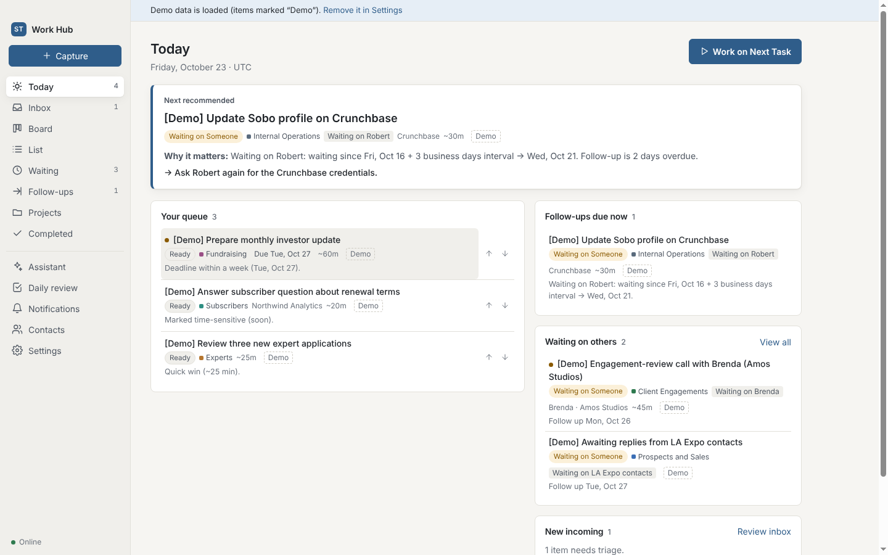

# ST Work Hub

A personal desktop work hub for Sobo's COO. It captures incoming work (quick tasks, pasted emails, meeting notes, lists), turns it into reviewed tasks, tracks ownership and waiting states, and helps you work through tasks one at a time. An optional Claude-powered assistant is included.

- **Stack:** Electron 44 · React 19 · TypeScript · SQLite (sql.js / WebAssembly) · Vite · optional Anthropic SDK
- **Works fully offline without an API key.** AI only improves intake and answers. It never changes data without your confirmation.
- **Single user, local data.** Nothing leaves your Mac except AI requests, and only when you enable AI.



---

## 1. Install and launch (MacBook)

Requirements: **Node.js 20 or newer** (tested on Node 22) and npm. Xcode is not needed because the app has no native modules.

```bash
# from the repository root
cd st-work-hub
npm install          # downloads Electron for your Mac (arm64 or Intel)
npm start            # builds and opens ST Work Hub in its own window
```

The first launch creates the database and loads clearly labelled **demo data**. You can remove it from Settings → Demo data with **Remove demo data**.

### Development mode (hot reload for the UI)

```bash
npm run dev
```

### Build a double-clickable Mac app

```bash
npm run dist:mac
```

This produces, in `st-work-hub/release/`:
- `ST Work Hub-0.1.0-arm64.dmg` (Apple Silicon) and `ST Work Hub-0.1.0.dmg` (Intel)
- matching `.zip` files

Open the `.dmg` and drag **ST Work Hub** to Applications.

**The build is unsigned**, because signing needs your Apple Developer ID certificate. On first launch macOS Gatekeeper will block it. Either:
- right-click the app → **Open** → **Open**, or
- System Settings → Privacy & Security → **Open Anyway**, or
- `xattr -dr com.apple.quarantine "/Applications/ST Work Hub.app"`

To sign and notarize later: set `identity` in `electron-builder.yml` (or `CSC_LINK` / `CSC_KEY_PASSWORD`), turn `hardenedRuntime` on, and add notarization credentials, then run `npm run dist:mac`.

---

## 2. Where your data lives

| What | Location (macOS) |
|---|---|
| Database (SQLite) | `~/Library/Application Support/ST Work Hub/st-work-hub.sqlite` |
| Automatic backups | `~/Library/Application Support/ST Work Hub/backups/` (one per day, last 14 kept, plus a `pre-restore` copy before every restore) |
| Encrypted API key | `~/Library/Application Support/ST Work Hub/anthropic-api-key.enc` (encrypted by Electron `safeStorage`, whose key lives in your macOS Keychain) |

Settings → **Data, backup & export** shows the exact paths and offers:
- **Export JSON (full):** tasks, notes, checklists, categories, contacts, projects, sources, activity and settings.
- **Export tasks CSV:** for spreadsheets. Formula-injection-safe.
- **Restore from JSON…:** validates the file, backs up the current database, then replaces all data.
- **Back up now** and **Open data folder**.

Every write is a SQLite transaction. The file is written atomically (temp file, fsync, rename), so a crash cannot leave a half-written database. Schema changes go through numbered migrations (`src/main/db.ts`, `schema_migrations` table).

---

## 3. Using it

| Area | What it does |
|---|---|
| **Today** | Next recommended task and *why*, your short queue (reorder with ↑/↓), follow-ups actually due, overdue deadlines, what you're waiting on, new incoming items. A collapsible list shows what's hidden and why (deferred, owned by others, closed contact, blocked). |
| **Work on Next Task** (or press `F`) | Focus mode: one task with context, next action, notes and checklist. Start · Complete · Add note · Defer… · Waiting on… · Skip… (with a reason) · Open source. Shows its queue position and lets you move it earlier or later. |
| **Capture** (`N`, or the global shortcut) | Quick task (straight to the Inbox), Email / thread, Meeting notes, List of responsibilities. Pasted text is stored verbatim as the source. |
| **Inbox** | Suggestions to review. Each field is marked *stated* (with the quote) or *inferred*; missing info is flagged, not invented; possible duplicates offer **Merge into this**. Nothing is added until you click. |
| **Board** | Drag cards between statuses (or Alt+←/→ on a focused card). Moving a card to Waiting asks who you're waiting on. |
| **List / Completed** | Searchable, sortable tables. Filters: owner, category, company, priority, status, date range. |
| **Waiting** | Grouped by person, with follow-up dates and their basis. Also lists tasks owned by others. |
| **Follow-ups** | Overdue / today / upcoming next-action and follow-up dates. Closed contacts appear only in a "suppressed" group. |
| **Projects** | Milestones, grouped tasks, dependencies, and each project's next task. |
| **Assistant** | Ask about your work. Answers cite the saved records they used. Proposed changes and drafts wait for confirmation. |
| **Daily review** | Completed today, unfinished, newly blocked, tomorrow's suggested priorities. |
| **Notifications** | In-app notification center: snooze (1h / tomorrow), dismiss, mute a task. |
| **Contacts** | Mark a contact **Closed** to stop all outreach and follow-up suggestions for them. |
| **Settings** | Name and aliases, timezone, theme (light/dark/system), follow-up intervals (global, per category, per task), business days, reminder hour, desktop and in-app toggles, global shortcut, AI key and model, categories, export/restore, demo data, integrations. |

Keyboard: `1`–`8` switch views, `N` capture, `F` focus, `Esc` closes dialogs and the details panel, `Tab` moves through everything. Modals trap focus.

### Statuses, importance and urgency
Statuses: Inbox · Ready · In Progress · Waiting on Someone · Scheduled · Done · Closed / No Action.
**Importance** (Critical/High/Medium/Low) and **Urgency** (Urgent/Soon/Not time-sensitive) are separate fields. **Due date** is for real deadlines only. **Next-action date** is when to revisit, and doubles as "defer until".

### How the queue is ordered (deterministic, `src/shared/queue.ts`)
- **Excluded:** done/closed; Inbox (triage first); next-action date in the future (deferred); waiting tasks whose follow-up isn't due; tasks owned by someone else with no coordination step for you; outreach to closed contacts; unfinished dependencies; tasks skipped today.
- **Scored:**

  | Signal | Points |
  |---|---|
  | Overdue deadline | 50 + 2 per day late, max +20 |
  | Due today | 40 |
  | Due within 3 days | 25 |
  | Due within 7 days | 10 |
  | Importance | 0–30 |
  | Urgency | 0–20 |
  | In progress | +15 |
  | Next-action date reached | +10 or more |
  | Quick win (≤30 min) | +5 |
  | Follow-up due | 35 + 3 per day overdue |

- Manual ordering (↑/↓ or Earlier/Later) overrides the score until you choose **Reset to automatic order**.

### Follow-up logic (`src/shared/followup.ts`)
- The follow-up date is the next-action date you set; otherwise it is the last follow-up sent (or the waiting-since date) plus the interval. The interval comes from the task, then its category, then the global default, counted in business days if configured.
- The basis is always shown, for example *"Waiting on Robert: waiting since Fri, Oct 16 + 3 business day interval → Wed, Oct 21."*
- **Log follow-up sent** moves the anchor to today, so there is no immediate duplicate reminder.
- Reminders have a fingerprint of kind + task + date. An unchanged item never notifies twice; snoozed reminders resurface once.

---

## 4. AI assistant (optional)

1. Get an API key at console.anthropic.com.
2. Settings → AI → paste the key → **Save key**.

How it works:
- **Model:** `claude-opus-5-5` by default (editable in Settings). Requests use structured JSON output and the server-side refusal fallback.
- **Intake:** the AI splits text into tasks, marks each value as explicit or inferred, quotes its evidence and flags gaps. The app then re-checks the output: a deadline is kept only if its quoted evidence actually appears in your text. Unknown categories and closed-contact outreach are flagged.
- **Assistant:** the AI receives your saved task data plus the deterministic engine's answer, and returns an answer, the task IDs it relied on, and optional proposals. Proposals that reference unknown tasks, or drafts to closed contacts, are discarded with a notice.
- **Never applied silently:** every AI change is a pending proposal. Update proposals show current versus proposed values with per-field checkboxes. If the task changed after the proposal was made, applying is refused until you confirm against the current values.
- **Drafting ≠ sending:** drafts can be copied to Outlook; **I sent it — log follow-up** is a separate, manual step. The app cannot send email or calendar invites.
- **Prompt-injection posture:** pasted emails and notes are wrapped as untrusted data, and the system rules say to never follow instructions inside them. The model has no tools that act, and all output is schema-validated and re-validated before it becomes a proposal.
- **Without a key, or offline:** intake uses a rule-based parser and the assistant uses a built-in engine. Both work from the same saved data.

---

## 5. Security notes

- Renderer runs with `contextIsolation`, `sandbox`, no Node integration, and a strict Content-Security-Policy. The preload exposes a fixed, typed API (`src/shared/ipc.ts`), and IPC handlers reject requests that don't come from the app window.
- Pasted content is rendered only as React text (no `innerHTML` anywhere). External links open in your browser and are limited to `http`, `https`, `mailto` and `ms-outlook`.
- The API key is stored encrypted via `safeStorage` (Keychain-backed on macOS), held only in the main process, and never sent to the renderer or logged; AI error messages redact keys. If OS encryption is unavailable, the key is kept in memory for the session only.
- No secrets in source code.

---

## 6. Outlook integration (not available yet)

`src/main/connectors/types.ts` defines the connector interface, and `src/main/connectors/outlook.ts` is a stub that reports **unavailable**. There is no simulated connection. The planned design:
- Microsoft Graph with OAuth 2.0 authorization code + PKCE via the system browser.
- Least-privilege delegated scopes: `Mail.Read` and `offline_access`.
- Reads only emails you select, and preserves `webLink` and `conversationId` so each task links back to the original thread.
- Feeds the same review-first intake pipeline.

---

## 7. Verification

```bash
npm run typecheck     # TypeScript, no errors
npm test              # 27 unit/integration tests (vitest) against real SQLite files
npm run test:e2e      # 8 end-to-end tests driving the built Electron app (Playwright)
                      # on Linux CI: xvfb-run -a npm run test:e2e
```

Results in the build environment:

| Behavior from the brief | Verified by |
|---|---|
| Tasks survive an application restart | `behaviors.test.ts › persistence` (close/reopen DB) and e2e `data survives an application restart` (real app quit + relaunch) |
| Status changes are reflected across views | `behaviors › status changes`; e2e: edit in panel → Board column → Today queue; drag-and-drop → List |
| Deferred tasks appear when due | `behaviors › deferral` (absent Fri/Sat/Mon, present Tuesday) |
| Waiting tasks stay separate from actionable work | `behaviors › waiting and follow-ups`; demo-data test |
| AI suggestions cannot silently overwrite tasks | `behaviors › AI update proposals cannot silently overwrite`; `ai-mock.test.ts` (real SDK path against a mock API) |
| Duplicate intake is flagged | `behaviors › duplicate intake`; e2e intake review (merge into existing) |
| Closed contacts stay out of outreach | `behaviors › closed contacts`; e2e assistant refuses a draft to Stephanie Reese |
| Export and restore preserve task data | `behaviors › export and restore` (byte-identical task JSON after round trip; CSV row count and escaping) |
| Reminders don't repeat; logged follow-ups don't re-remind | `behaviors › an unchanged reminder is never repeated`, `logging a sent follow-up…` |

The packaged app (`electron-builder --linux dir`) was also built and launched to confirm the bundle opens its database and writes the daily backup.

---

## 8. Known limitations

- **No signed Mac installer from this environment.** It was built on Linux, so `npm run dist:mac` must be run on your Mac. The output is unsigned until you add a Developer ID certificate (see §1).
- **AI was not exercised against the live API here** because no key was available. The request and parse path is tested against a local mock of the Messages API; the first real call happens when you add your key.
- The offline parser is intentionally simple: bullets and request-like sentences, "X to/will …" owners, explicit "by Friday"-style deadlines. Use AI for messy threads.
- The global shortcut must not clash with other apps; change it in Settings if it doesn't fire.
- sql.js keeps the database in memory and rewrites the file on each change. That is ideal for one person's task data (thousands of tasks), not for very large datasets.
- Desktop notifications rely on macOS notification permission for the app (System Settings → Notifications).
- Outlook integration is a documented interface only (§6).

## 9. Project layout

```
src/shared/     pure domain logic: types, dates, queue/prioritization, follow-ups, intake parser,
                duplicates, local assistant, demo data, CSV, IPC contract
src/main/       Electron main: db (sql.js + migrations), repo, services (intake/assistant/reminders/
                backup/restore), ai (Anthropic SDK), credentials (safeStorage), connectors/, main.ts
src/preload/    contextBridge API
src/renderer/   React UI: views/, components/, store.tsx, styles.css
tests/          vitest suites;  e2e/  Playwright Electron tests
```
